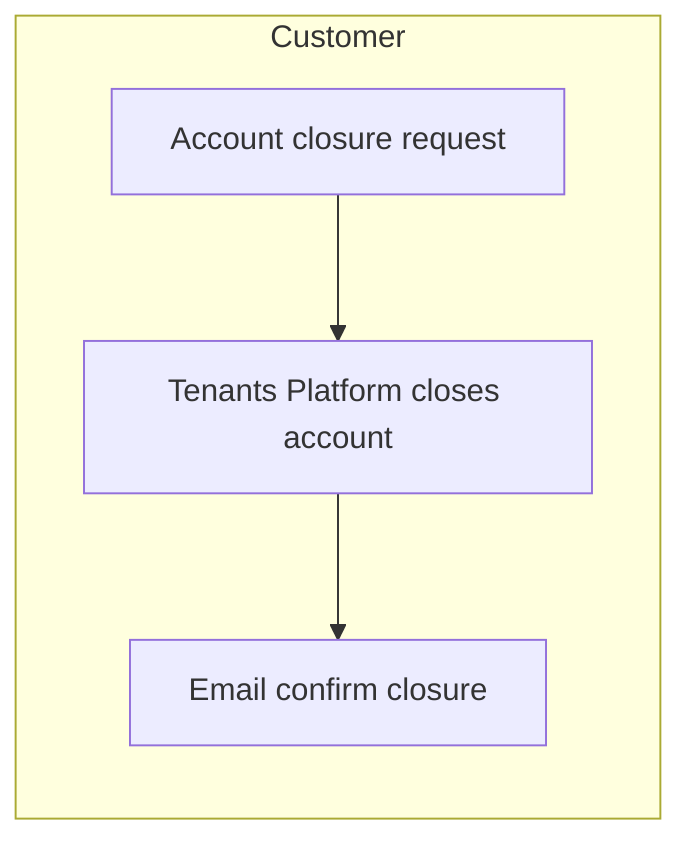
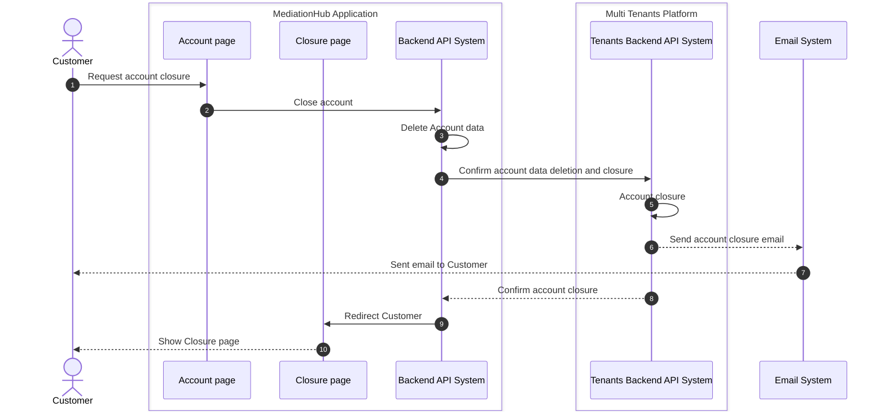

# Account Closure

Account closure process is the process of closing an account from the system.

## Pre-conditions

- Customer has an up-to-date payment history.

## Process Flow

High-level process

Detailed sequence diagram

## Post-conditions

- Account data is delete from MediationHub.
- Account is closed on Multi Tenants Platform.
- TODO: Process refunds

## Data Input

- Account payment status
- Account ID

## Data Output

- Account closure status
