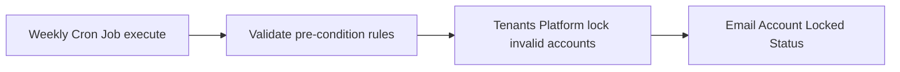
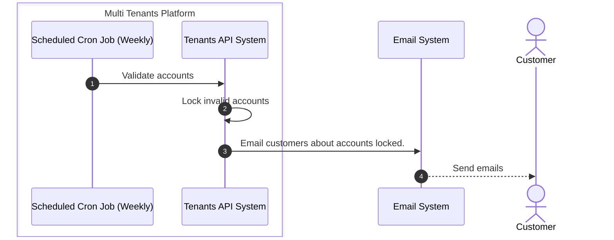

# Account Lock

Account Lock process is about an locking account holder access to not login to an application instance due to business rules. 

## Pre-conditions

- Email address not confirmed.
- Payment not made.

## Process Flow

High-level process

Detailed sequence diagram

## Post-conditions

- Invalid Accounts are locked.
- Customers are informed via email.
- TODO: Map reactivation process to unlock account.

## Data Input

- Account email address confirmation status.
- Account payment status.

## Data Output

- Account locked status.
