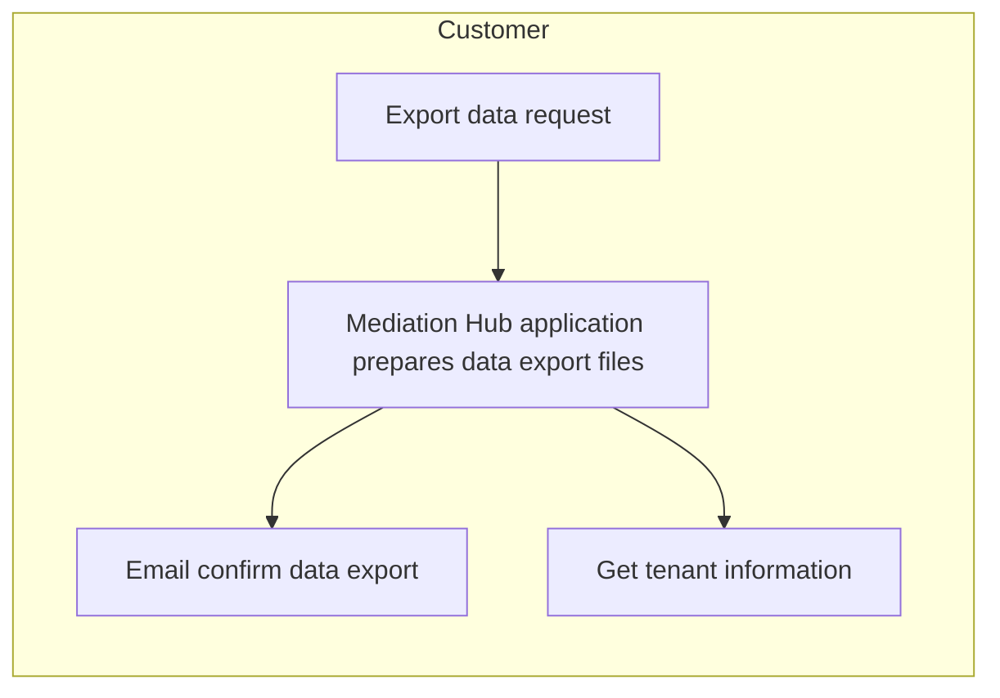
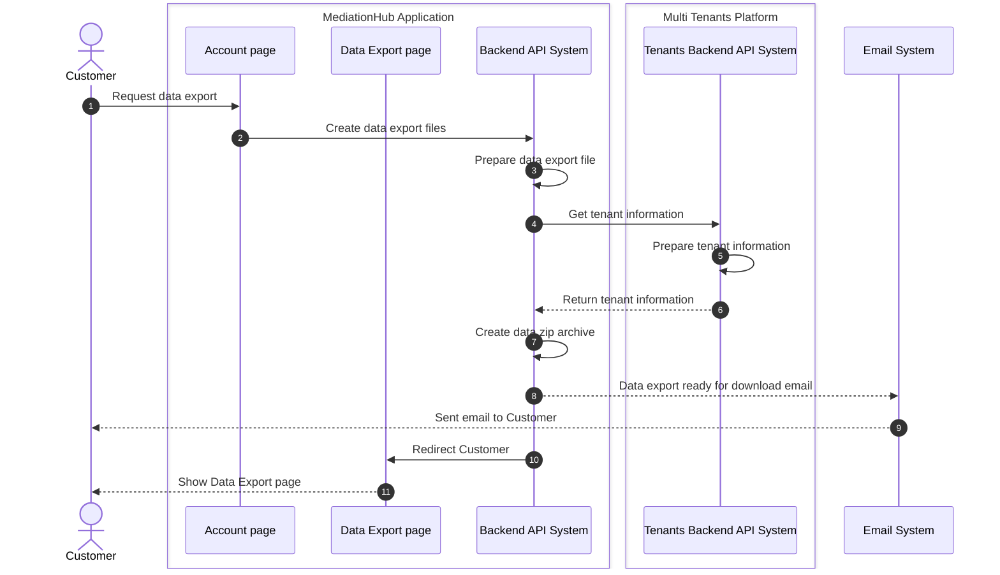

# Data Export

Data Export process is about an account holder requesting the export of all their data in the system to be downloaded. 

## Pre-conditions

- - Customer has an up-to-date payment history.

## Process Flow

High-level process

Detailed sequence diagram

## Post-conditions

- TBD

## Data Input

- TBD

## Data Output

- TBD
