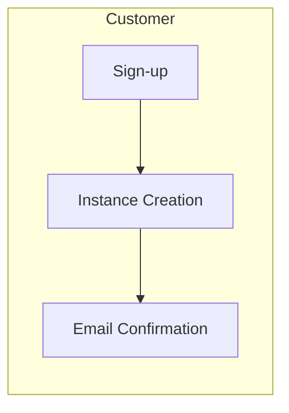
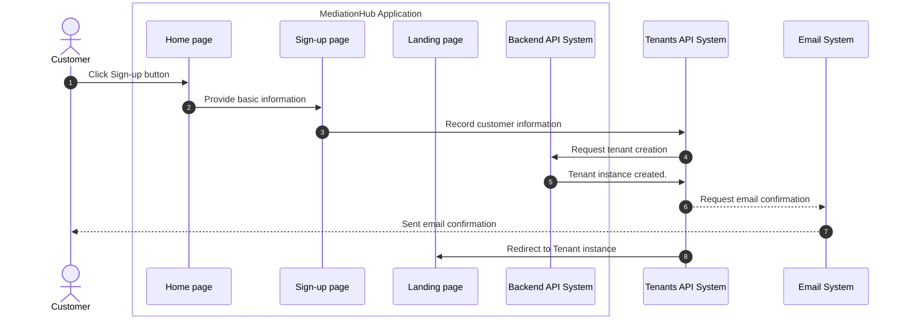

# Registration Onboarding

Registration Onboarding process is about signing up to use the system.

## Pre-conditions

- N/A

## Process Flows

High-level process

Detailed sequence diagram

## Post-conditions

- Account holder has verified email address.
- Account instance is successfully created.
- No payment is required at sign-up. Payment is requested after 14 days.

## Data Input

- Company Name
- Account Holder Full name (First name, Last name)
- Country
- Account Holder Email address

## Data Output

- Instance ID
- Encryption Key
  - Used to encrypt clients personal information.
